# HookDeck: Webhook Sender

<p align="center">
  <b>A streamlined mobile & web workstation for dispatching messages, media, and binary file attachments through webhooks in 1–2 taps.</b>
</p>
<p align="center">
  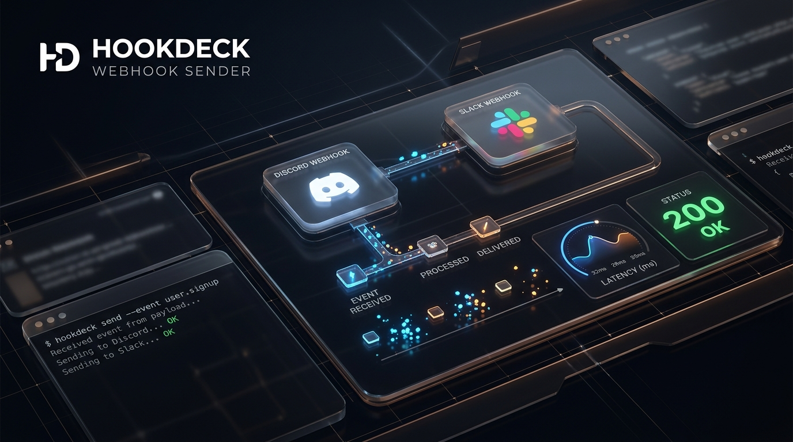
</p>

<p align="center">
  
  
  
  
  
  
</p>

---

## 🏛 Design Philosophy: Clean Focus & Minimalist Dispatch

HookDeck delivers an intentional, distraction-free experience crafted around rapid dispatching:

- **Signature HookDeck Emblem**: Integrated seamlessly across the navigation bar, identity headers, onboarding states, and app icons.
- **Harmonious Dual Themes**: 
  - **Espresso Noir (Dark)**: Smoked obsidian backdrops (`#0F0E0D`), hairline bronze borders (`#C59B6D33`), and warm muted cards.
  - **Alabaster Ivory (Light)**: Pure silk ivory linen surfaces with warm saddle brown typography and accents.
- **Editorial Typography**: Pairing `Plus Jakarta Sans` for brand headings, `Inter` for clean prose, and `JetBrains Mono` for masked tokens and latency telemetry.
- **Genuine Identity Ownership**: No forced generic emojis. Users can link custom avatar image URLs (e.g. Unsplash, GitHub, internal CDNs), choose custom monogram accents, or display the HookDeck emblem.

---

## 📸 Visual Showcase & Screen Flows

### 1. Bespoke Identity Management (`L` Profile Showcase)

Create and manage custom sender identities with real custom image URLs and live Discord/Slack preview cards:

| 1. Profiles Home Screen | 2. Identity Creator & Live Preview |
|:---:|:---:|
| 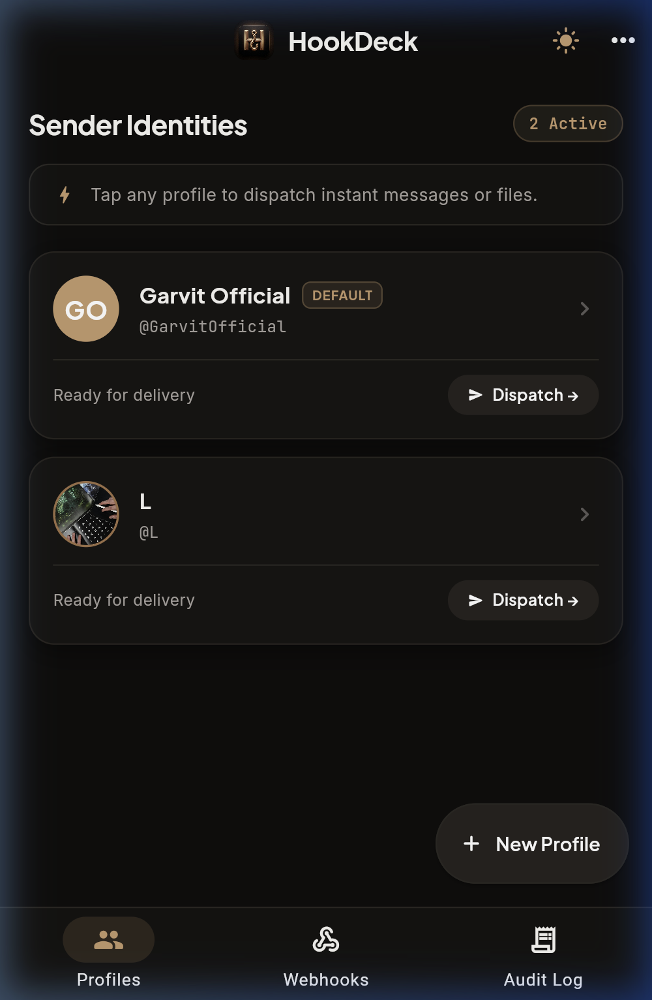 | 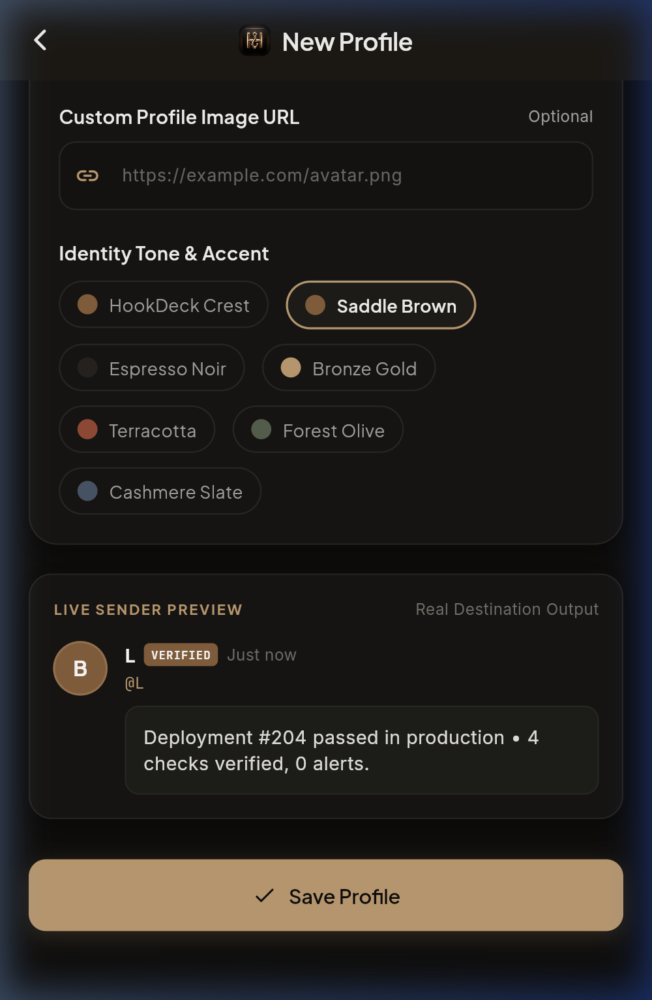 |
| *Active identity cards featuring profile `L` with custom Unsplash avatar and 1-tap dispatch* | *Identity creator with live destination preview card and customizable tone swatches* |

---

### 2. Destination Management & Webhook Auto-Detection

Connect and manage live webhooks with instant platform auto-detection and masked secure URLs:

| 3. Connected Destinations (`L` Discord Webhook) | 4. Add Destination Sheet |
|:---:|:---:|
| 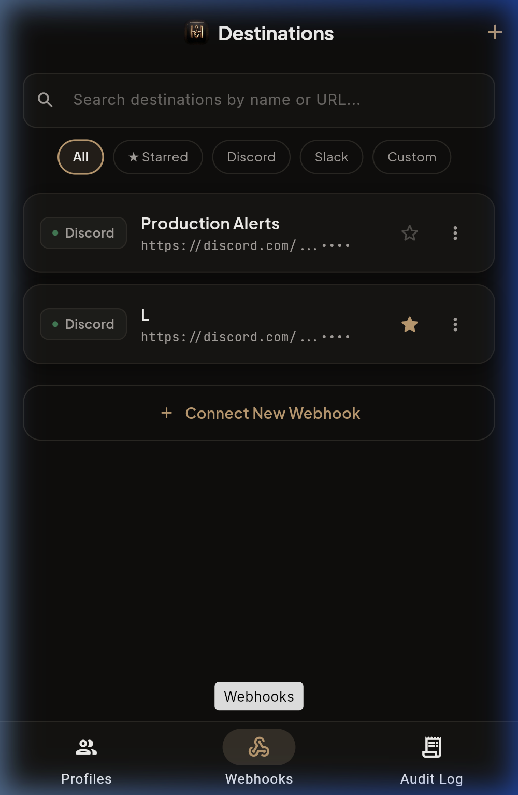 | 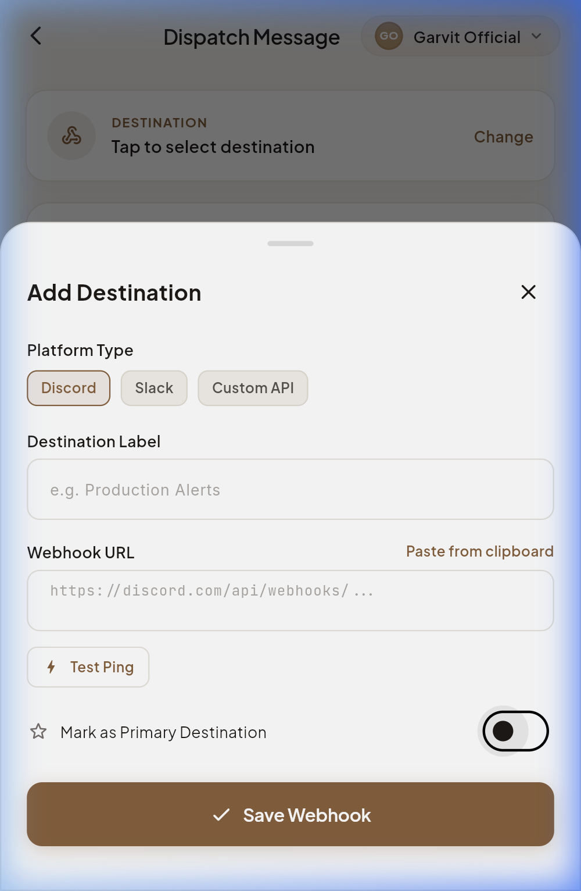 |
| *Live Discord destination `L` with starred favorites, masked URLs, and test pinging* | *Auto-detection for Discord, Slack, and generic webhooks with connection testing* |

---

### 3. Rapid 2-Tap Dispatch with Real File Attachments

Dispatch messages and real device attachments with zero clutter, clean empty states, and verified round-trip telemetry receipts:

| 5. Dispatch Composer (Sender `L` ➔ Destination `L`) | 6. Verified Delivery Receipt (`204 OK` in 799ms) |
|:---:|:---:|
| 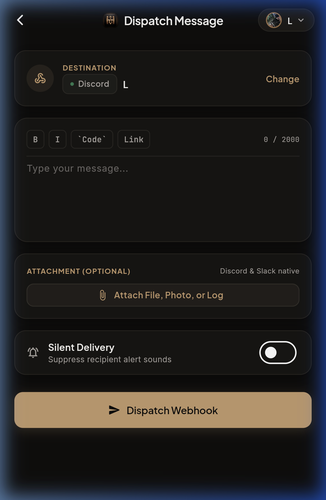 | 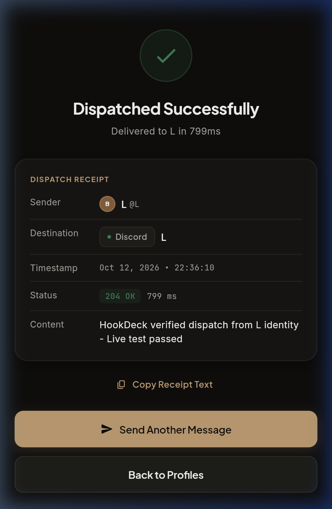 |
| *Clean composer with optional native system file picker (`FilePicker`) and markdown toolbar* | *Round-trip delivery receipt showing status `204 OK` in 799ms delivered live to Discord* |

---

### 4. Dual Editorial Themes

| Espresso Noir (Dark Theme) | Alabaster Ivory (Light Theme) |
|:---:|:---:|
| 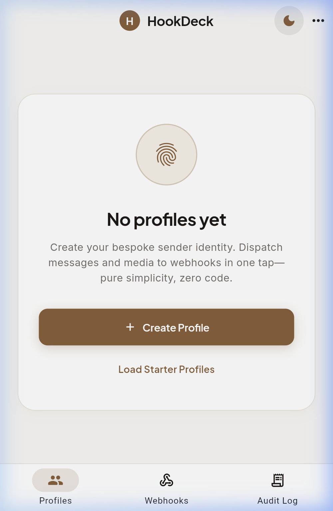 | 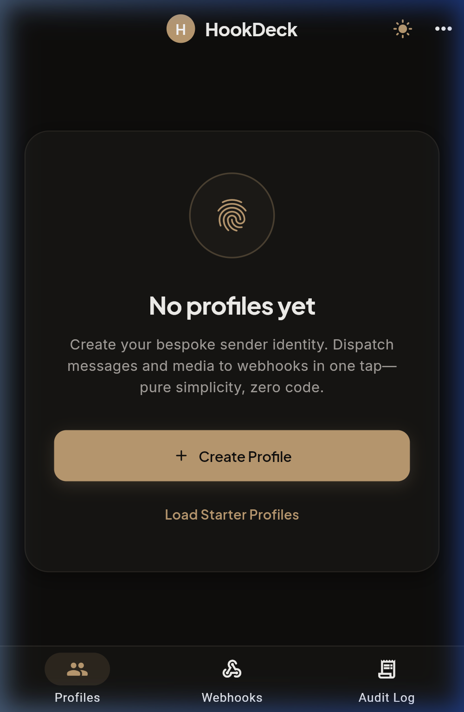 |
| *Smoked obsidian surfaces with bronze gold accents* | *Warm ivory linen with rich saddle brown accents* |

---

## ✨ Core Capabilities

- **⚡ 2-Tap Dispatch Flow**: Select your profile, type your message, and tap Dispatch. Delivers live across webhooks in under a second.
- **📎 Real Native File Uploads (`multipart/form-data`)**:
  - Tapping **Attach File, Photo, or Log** opens the native system picker.
  - Uploads real binary bytes to Discord channels using standard `payload_json` + `files[0]` multipart format.
  - Generous 90-second streaming timeout ensures high-resolution images and large logs upload without false timeout warnings.
  - Dynamic button progress: shows **`Uploading & Dispatching...`** while transferring files.
- **🛡️ Modern Scoped Storage & Security**:
  - **Zero Invasive Storage Permissions**: Neither `READ_EXTERNAL_STORAGE` nor `MANAGE_EXTERNAL_STORAGE` is requested.
  - Exclusively uses native **Storage Access Framework (SAF)** / system photo picker for ephemeral user-selected file reads.
  - Client-side isolated direct transmission over TLS/HTTPS.
- **🔔 Floating Feedback & Inline Validation**:
  - High-contrast floating toasts ([AppFeedback](file:///Users/ganu/Programming/dcWebhook/lib/widgets/app_feedback.dart)) with glowing status icons.
  - Inline error notice directly above the dispatch button ensures clear visibility on all viewport heights.
- **🎯 Smart Webhook Auto-Detection**: Paste any URL—HookDeck automatically detects Discord (`/api/webhooks/`), Slack (`/services/hooks/`), or generic HTTP endpoints.
- **📊 Round-Trip Latency Telemetry**: Stopwatch measures execution speed in milliseconds (`ms`) and logs receipt status codes (`200 OK`, `204 No Content`).
- **🔕 Silent Delivery Toggle**: Dispatch notifications with suppression flags (`4096` on Discord) to avoid ringing channel alerts.
- **💾 Local Persistence**: Profiles, destinations, and delivery history are stored locally via `SharedPreferences`.

---

## 🛠 Tech Stack

- **Framework**: [Flutter 3.38.5](https://flutter.dev) (Dart 3.10+)
- **File Management**: `file_picker: ^13.1.0` (Storage Access Framework compliant)
- **State & Storage**: `ChangeNotifier`, `shared_preferences: ^2.5.5`
- **Network & Telemetry**: `http: ^1.6.0` (with live round-trip latency stopwatch and multipart streams)
- **Typography**: [Google Fonts](https://pub.dev/packages/google_fonts) (`Plus Jakarta Sans`, `Inter`, `JetBrains Mono`)
- **Unique Identifiers**: `uuid: ^4.6.0`
- **Date & Number Formatting**: `intl: ^0.20.3`

---

## 📐 Technical Architecture & Wire Pipeline

HookDeck operates as an isolated, client-side dispatcher without intermediary proxies or cloud relays. Network payloads stream directly from the device sandbox to the target webhooks over TLS 1.3.

### 1. Multi-Tier System Data Flow

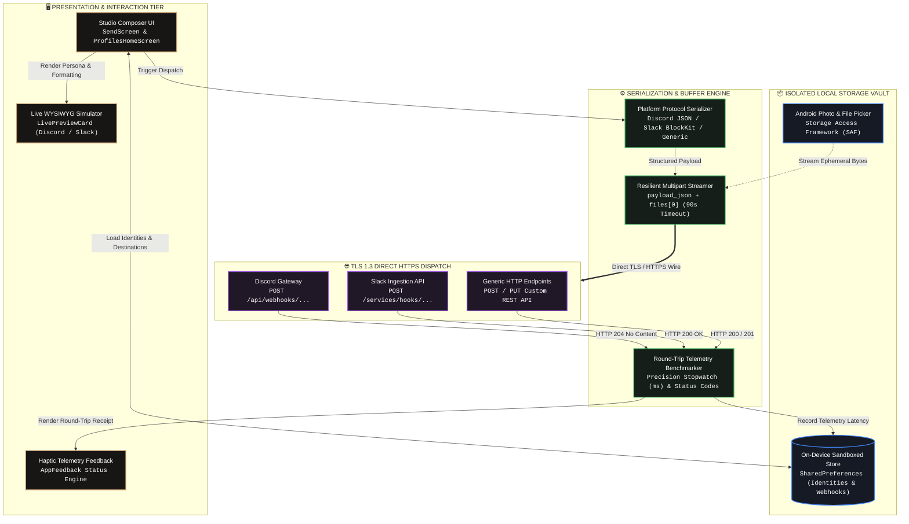

### 2. Wire Dispatch Lifecycle Sequence

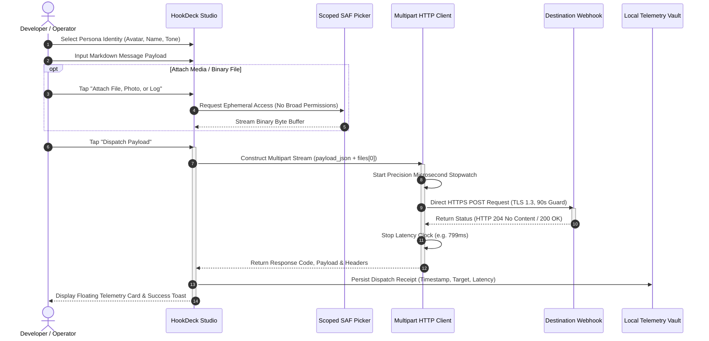

### 3. Dispatch Pipeline State Machine

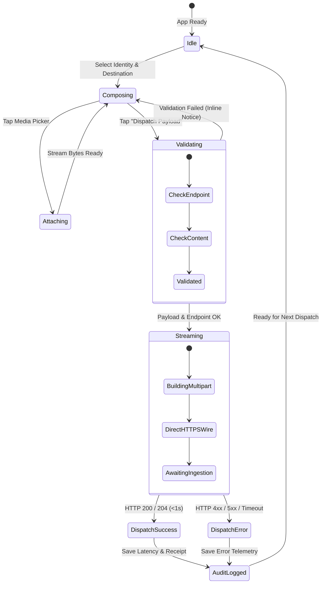

---

## 🚀 Getting Started

### Prerequisites

- Flutter SDK `>=3.3.0` installed ([Install Flutter](https://docs.flutter.dev/get-started/install))
- Chrome or modern web browser (for web preview)
- Android Emulator / Physical Device (for mobile testing)

### Installation

```bash
# Clone the repository
git clone https://github.com/GarvitOfficial/hookDeck.git
cd hookDeck

# Install dependencies
flutter pub get

# Verify codebase
flutter analyze
flutter test
```

### Running Locally

#### Run on Web
```bash
flutter run -d web-server --web-port 8080 --web-hostname 0.0.0.0
# Or directly in Chrome:
flutter run -d chrome
```
Open [http://localhost:8080](http://localhost:8080) in your browser.

#### Run on Android
```bash
flutter run -d android
```

#### Build Production Artifacts
```bash
# Build Android APK:
flutter build apk --release

# Build Android App Bundle:
flutter build appbundle --release

# Build Web Bundle:
flutter build web --release
```

---

## 📁 Project Architecture

```
lib/
├── main.dart                      # App entry point & ThemeProvider initialization
├── models/
│   ├── profile.dart               # Sender identity model (customImageUrl, monogram, tone)
│   ├── webhook_target.dart        # Target endpoint model (platform auto-detect, masked URLs)
│   └── dispatch_record.dart       # Telemetry record (latencyMs, statusCode, payload)
├── screens/
│   ├── profiles_home_screen.dart  # Home identity cards & navigation holder
│   ├── create_profile_screen.dart # Bespoke avatar uploader & live preview
│   ├── profile_detail_screen.dart # Identity overview & quick actions
│   ├── send_screen.dart           # Dispatch composer with real file picker & markdown tools
│   ├── send_success_screen.dart   # Telemetry receipt & copy breakdown
│   ├── webhooks_list_screen.dart  # Endpoint manager with search & filter chips
│   ├── add_webhook_sheet.dart     # Auto-detecting endpoint connection modal
│   ├── history_screen.dart        # Audit trail of sent dispatches
│   └── empty_state_view.dart      # Minimalist onboarding screen with emblem
├── services/
│   ├── storage_service.dart       # SharedPreferences persistence & demo seed data
│   └── webhook_service.dart       # Multipart streaming HTTP client with Discord/Slack transformers
├── theme/
│   ├── app_theme.dart             # Refined design tokens (Espresso Noir & Alabaster Ivory)
│   └── theme_provider.dart        # Reactive light/dark theme switcher
└── widgets/
    ├── app_feedback.dart          # Floating high-contrast status toast system
    ├── destination_chip.dart      # Platform badge (Discord, Slack, Generic)
    ├── glowing_avatar.dart        # Network image avatar with monogram fallback
    ├── live_preview_card.dart     # Discord/Slack simulation card
    ├── tactile_button.dart        # Tactile pill CTA button with haptic feedback
    └── glass_card.dart            # Hairline border obsidian container
```

---

## 👤 Author

**GarvitOfficial** ([@GarvitOfficial](https://github.com/GarvitOfficial))
