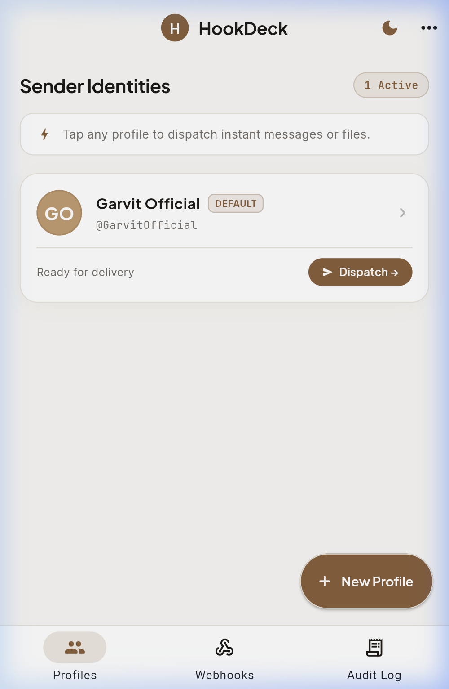
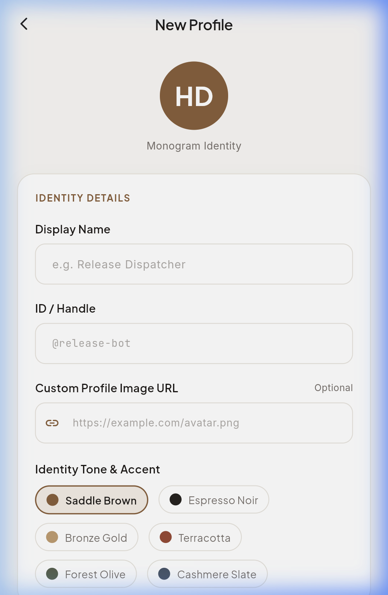
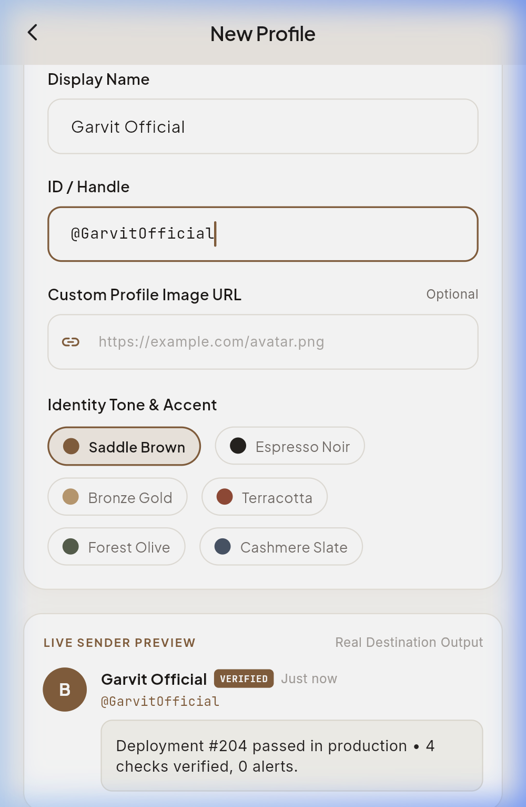
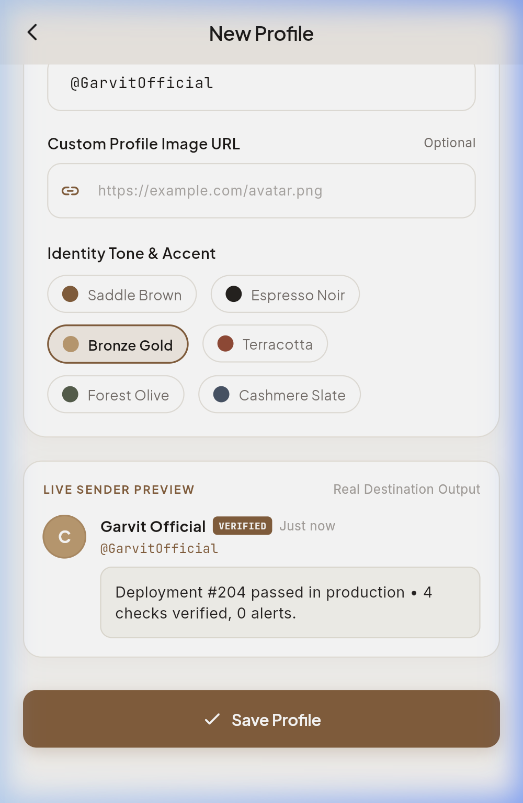
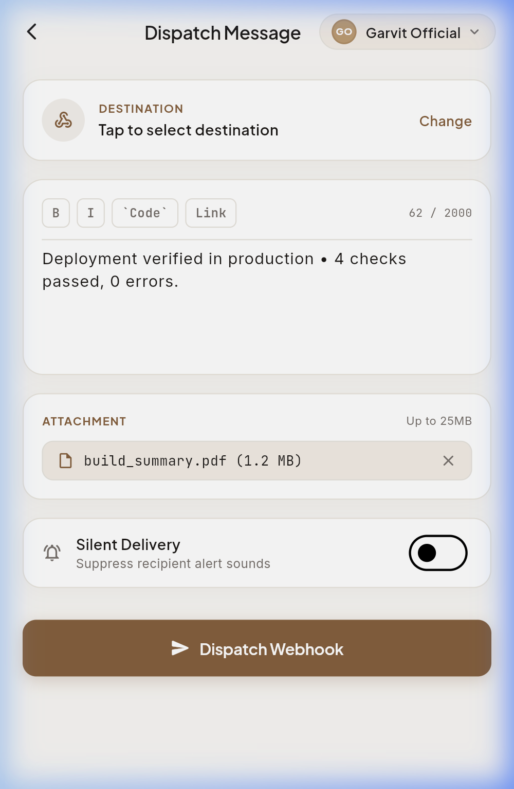
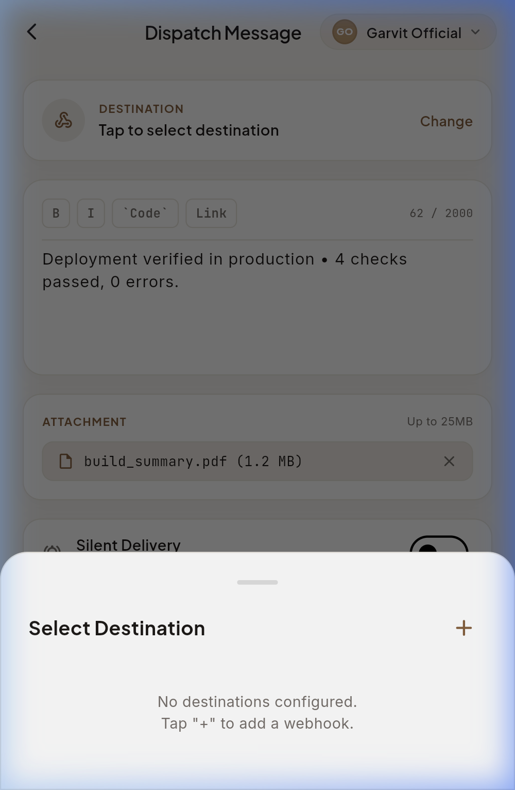
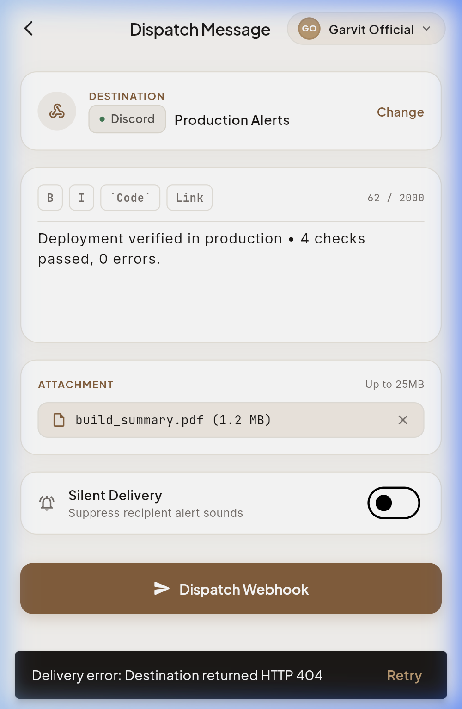
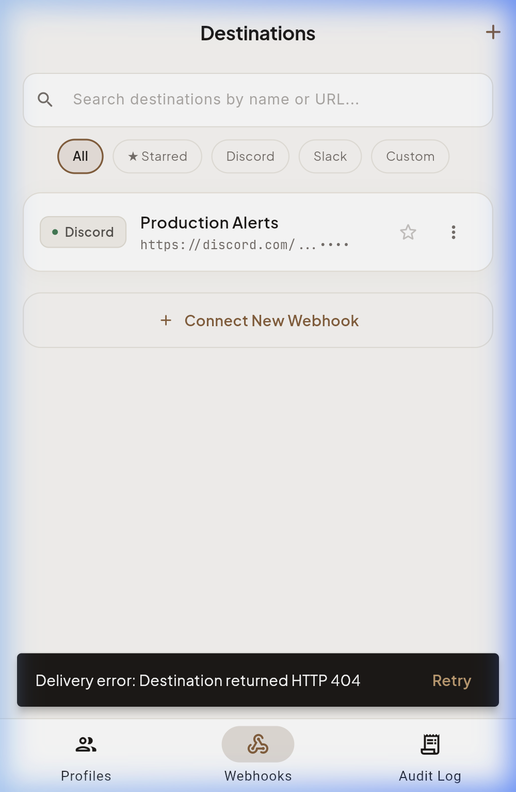
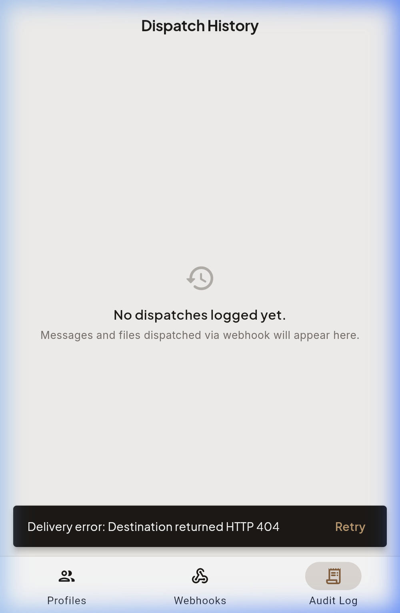

<p align="center">
  
</p>

# HookDeck ✦ Quiet Luxury Webhook Dispatcher

<p align="center">
  <b>A minimalist, bespoke Flutter mobile & web application for dispatching messages, telemetry, and file attachments through webhooks in 1–2 taps—without writing code.</b>
</p>

<p align="center">
  
</p>

<p align="center">
  
  
  
  
  
</p>

---

## 🏛 Design Philosophy: Quiet Luxury & Architectural Minimalism

HookDeck is designed around calm, editorial elegance and zero AI-generated visual clutter:

- **Earthy Luxury Palette**: Warm skinny saddle brown (`#8C5E38`), soft bronze gold (`#C59B6D`), rich espresso noir (`#0F0E0D`), and warm alabaster ivory (`#F9F7F4`).
- **Harmonious Dual Themes**: 
  - **Espresso Noir (Dark)**: Deep smoked obsidian tones with hairline bronze borders.
  - **Alabaster Ivory (Light)**: Pure silk ivory backgrounds with warm saddle brown accents.
- **Editorial Typography**: Premium typography pairing `Plus Jakarta Sans` for headings and brand elements, `Inter` for breathable body text, and `JetBrains Mono` for IDs and telemetry tokens.
- **User Empowerment & Identity Control**: No forced emoji presets. Users have complete freedom to upload custom profile image URLs, choose luxury accent tones, or use bespoke monograms.

---

## 📸 Visual Showcase & Screen Flows

### 1. Dual Luxury Themes (Espresso Noir & Alabaster Ivory)

| Dark Mode (Espresso Noir) | Light Mode (Alabaster Ivory) |
|:---:|:---:|
|  |  |
| *Deep warm void with hairline bronze accents* | *Warm natural linen with saddle brown focus* |

---

### 2. Sender Identity Management & Custom Avatars

Users can configure custom avatars with live previews simulating how messages will look in Discord and Slack:

| Sender Profiles Home | Create Identity & Monogram | Custom Image URL & Tones | Live Sender Preview |
|:---:|:---:|:---:|:---:|
|  |  |  |  |
| *Active identity cards with 1-tap dispatch* | *Clean inputs with instant validation* | *Custom image URL & luxury color swatches* | *Pixel-accurate Discord/Slack simulation* |

---

### 3. Rapid 2-Tap Dispatch Workflow

Compose markdown messages, attach files, select destinations, and receive real-time latency receipts:

| Dispatch Composer | Destination Modal | Add Webhook Sheet | Delivery Receipt & Telemetry |
|:---:|:---:|:---:|:---:|
|  |  |  |  |
| *Markdown toolbar & sample attachments* | *Masked URLs with quick-switch* | *Auto-detection for Discord, Slack, etc.* | *HTTP status, latency (ms), & copy receipt* |

---

### 4. Endpoints & Audit Logging

| Connected Webhook Destinations | Audit Log & Delivery Telemetry |
|:---:|:---:|
|  |  |
| *Search, platform filters, star favorites, and test pings* | *Timestamped audit trail with round-trip latency metrics* |

---

## ✨ Core Features

- **⚡ 2-Tap Dispatch**: Select your sender identity, type your message, and hit Dispatch. Webhook delivery executes instantly.
- **🎨 Custom Profile Avatars**: Paste any direct image URL (GitHub, Unsplash, internal CDN) or pick from 6 luxury monogram tones (`Saddle Brown`, `Espresso Noir`, `Bronze Gold`, `Terracotta`, `Forest Olive`, `Slate`).
- **🎯 Intelligent Webhook Auto-Detection**: Paste any URL—HookDeck automatically detects Discord (`/api/webhooks/`), Slack (`/services/hooks/`), or generic HTTP endpoints.
- **🔍 Ping & Verify**: Test endpoint reachability with a single tap before saving.
- **📊 Real-Time Telemetry & Receipts**: Measures round-trip HTTP request latency in milliseconds (`ms`) and logs status codes (`200 OK`, `204 No Content`).
- **📎 Media & File Simulation**: Seamlessly attach mock logs, PDFs, SQL dumps, or images up to 25MB.
- **🔕 Silent Delivery Toggle**: Dispatch notifications quietly without ringing recipient channel alerts.
- **💾 Local Persistence**: All profiles, endpoints, and audit records persist locally via `SharedPreferences`.
- **🌓 Persistent Theme Switcher**: Toggle effortlessly between Espresso Noir and Alabaster Ivory; theme preference is saved across sessions.

---

## 🛠 Tech Stack

- **Framework**: [Flutter 3.38.5](https://flutter.dev) (Dart 3.10+)
- **State & Storage**: `ChangeNotifier`, `shared_preferences: ^2.5.5`
- **Network & Telemetry**: `http: ^1.6.0` (with live round-trip latency stopwatch)
- **Typography**: [Google Fonts](https://pub.dev/packages/google_fonts) (`Plus Jakarta Sans`, `Inter`, `JetBrains Mono`)
- **Unique Identifiers**: `uuid: ^4.6.0`
- **Formatting**: `intl: ^0.20.3`

---

## 🚀 Getting Started

### Prerequisites

- Flutter SDK `>=3.3.0` installed ([Install Flutter](https://docs.flutter.dev/get-started/install))
- Chrome or any modern web browser (for web run)
- iOS Simulator / Android Emulator (for mobile run)

### Installation

```bash
# Clone the repository
git clone https://github.com/GarvitOfficial/HookDeck.git
cd HookDeck

# Install Flutter dependencies
flutter pub get

# Verify codebase
flutter analyze
flutter test
```

### Running Locally

#### Run on Web
```bash
flutter run -d web-server --web-port 8080 --web-hostname 0.0.0.0
# Or directly in Chrome:
flutter run -d chrome
```
Open [http://localhost:8080](http://localhost:8080) in your browser.

#### Run on Mobile (iOS / Android)
```bash
# Run on iOS Simulator
flutter run -d ios

# Run on Android Emulator / Device
flutter run -d android
```

#### Production Web Build
```bash
flutter build web --release
```
The compiled assets will be ready in `build/web/`.

---

## 📁 Project Architecture

```
lib/
├── main.dart                      # App entry point & ThemeProvider binding
├── models/
│   ├── profile.dart               # Sender identity model (customImageUrl, monogram, tone)
│   ├── webhook_target.dart        # Target endpoint model (platform auto-detect, masked URLs)
│   └── dispatch_record.dart       # Telemetry record (latencyMs, statusCode, payload)
├── screens/
│   ├── profiles_home_screen.dart  # Home identity cards & bottom navigation
│   ├── create_profile_screen.dart # Bespoke avatar uploader & live preview
│   ├── profile_detail_screen.dart # Identity overview & quick actions
│   ├── send_screen.dart           # Minimalist dispatch composer with markdown tools
│   ├── send_success_screen.dart   # Telemetry receipt & copy breakdown
│   ├── webhooks_list_screen.dart  # Endpoint manager with search & filter chips
│   ├── add_webhook_sheet.dart     # Auto-detecting endpoint connection modal
│   ├── history_screen.dart        # Audit trail of sent dispatches
│   └── empty_state_view.dart      # Minimalist onboarding screen
├── services/
│   ├── storage_service.dart       # SharedPreferences persistence & demo seed data
│   └── webhook_service.dart       # HTTP client with platform payload transformers
├── theme/
│   ├── app_theme.dart             # Luxury design tokens (Espresso Noir & Alabaster Ivory)
│   └── theme_provider.dart        # Reactive light/dark theme switcher
└── widgets/
    ├── destination_chip.dart      # Platform badge (Discord, Slack, Generic)
    ├── glowing_avatar.dart        # Network image avatar with monogram fallback
    ├── live_preview_card.dart     # Understated Discord/Slack simulation card
    ├── luxury_button.dart         # Weighted pill CTA button with haptic feedback
    └── luxury_glass_card.dart     # Hairline border minimalist container
```

---

## 👤 Author

**Garvit** ([@GarvitOfficial](https://github.com/GarvitOfficial))
